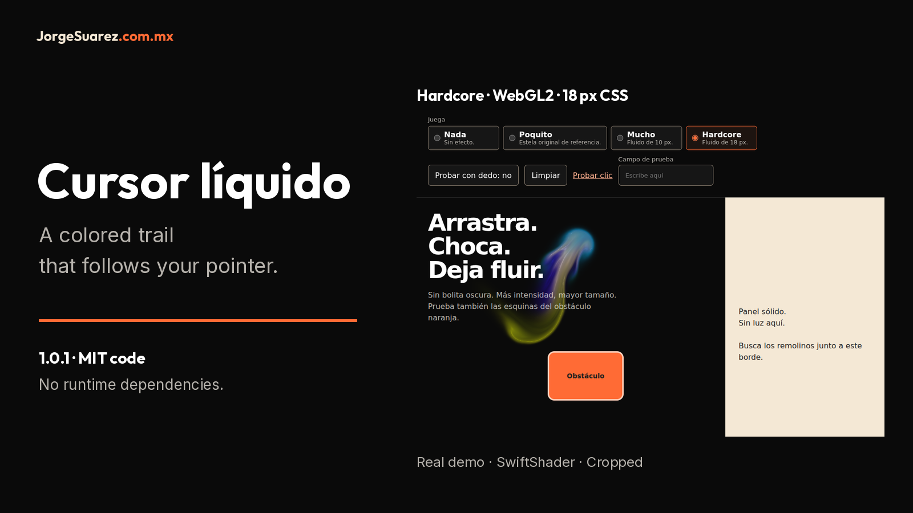
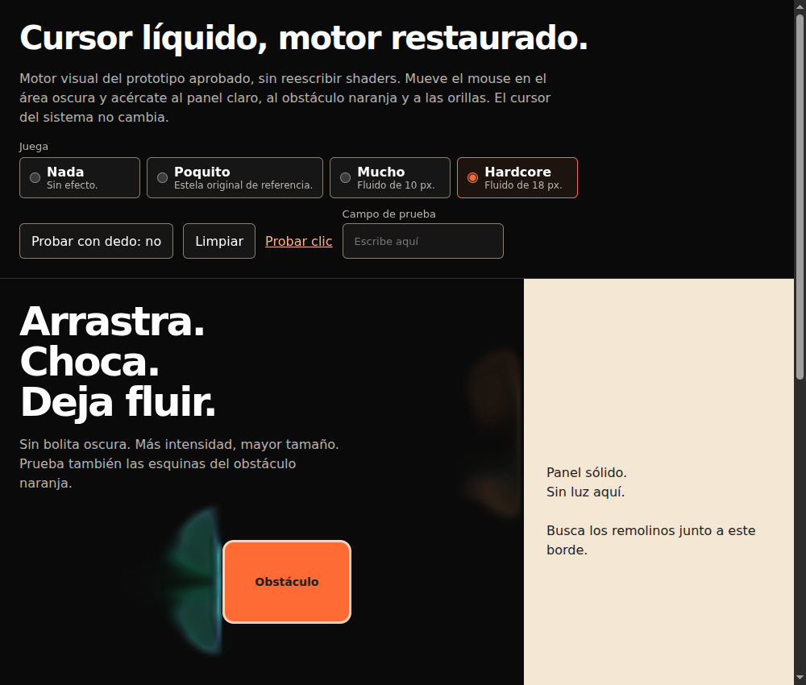
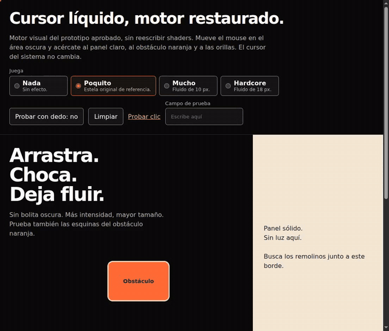

# Cursor líquido

English · [Español](README.md)

<picture>
  <source media="(max-width: 600px)" srcset="docs/media/cover-en-mobile.png">
  
</picture>

A colored trail that follows the pointer on your page. Built by [Jorge Suárez](https://brandkit.jorgesuarez.com.mx/).

[Download HTML demo 1.0.1](https://github.com/jorgefsb/cursor-liquido/releases/download/v1.0.1/cursor-liquido.html) · [Watch the real video (MP4, 13 s)](docs/media/cursor-liquido-restaurado-real.mp4)

## What is it?

A piece of code for web pages. It draws dots or fluid behind the pointer; it does not change the system cursor or intercept clicks. Code version in this checkout: 1.0.1, with no runtime dependencies.

## Who is it for?

People who own a web page and want a decorative mouse effect. You can try it without coding; adding it to your site requires access to its files and help from its developer. No Juice, Moki or account is required.

## Why was it made?

To share the effect from Jorge's pages as a reusable component, with four intensities and a way to turn it off. Decoration does not promise more sales or better usability.

## How do I use it?

First download or clone [this repository](https://github.com/jorgefsb/cursor-liquido). Double-click [demo/index.html](demo/index.html) to open it in your browser. Choose Poquito and move the mouse in the dark area. Try Mucho or Hardcore near the orange obstacle and light panel; Nada turns the effect off. Trying it does not require Node.

To share a single offline file, open [dist/cursor-liquido-standalone.html](dist/cursor-liquido-standalone.html). If you are reading on GitHub, download the file first: the code view does not run the demo. The original interface keeps its Spanish labels in the English guide too.



Real screenshot: Hardcore is selected; fluid appears next to the orange block and the light panel stays free of light. This is a sample, not device certification.

[Watch the real video (13 s)](docs/media/cursor-liquido-restaurado-real.mp4) · [EN captions](docs/media/walkthrough.en.vtt) · [Timestamped explanation](docs/walkthrough.en.md) · [Captioned player to open locally](docs/showcase.en.html)

To use the player, download or clone the repository and open `docs/showcase.en.html` in your browser. GitHub shows its source, not a hosted HTML player.

## When should or shouldn't I use it?

Use it as optional decoration on a dark page. Avoid text with marginal contrast, important forms or situations where it distracts. Reduced motion turns it off; touch is off by default. Mucho and Hardcore require WebGL2 and `EXT_color_buffer_float`; without them, no fluid is drawn. Poquito does not use WebGL.

Tested in headless Chromium with software WebGL (SwiftShader), not on physical phones or every GPU. `color` only changes Poquito; fluid is multicolored. There is no implemented Legendario level.

## Where can I try or download it?

In this local checkout: [demo](demo/index.html) or [standalone file](dist/cursor-liquido-standalone.html). Source: [jorgefsb/cursor-liquido](https://github.com/jorgefsb/cursor-liquido). Download the [Release v1.0.1 standalone HTML](https://github.com/jorgefsb/cursor-liquido/releases/download/v1.0.1/cursor-liquido.html) or [cursor-liquido-1.0.1.zip](https://github.com/jorgefsb/cursor-liquido/releases/download/v1.0.1/cursor-liquido-1.0.1.zip). These existing-release download links were verified by the repository owner; they are not a new publication from this work. A hosted public demo has not been verified here. There is no published npm package: do not use `npm install cursor-liquido`. This revision updates documentation; it does not change the runtime or create a new release.

## Cost, requirements and privacy

The code is free under [MIT](LICENSE), including commercial use, while retaining license notices. Integration, hosting and site support may have their own costs; installation services and guaranteed response times are not included. Engine attribution to Pavel Dobryakov is in [THIRD_PARTY_NOTICES](THIRD_PARTY_NOTICES).

To try it: a computer, browser and mouse; compatible WebGL2 for fluid. To integrate it: HTML/CSS/JavaScript and site access. Node 18 or newer and Playwright are only needed for development and tests.

The module runs in the browser: it includes no analytics, accounts or network requests. Pointer positions are processed in memory; the module does not store them in cookies or local storage. Destroying the instance removes its layers and listeners. The local demo works offline. This does not describe the policies of a host site or GitHub when downloading. The signature and brand images are not MIT: see the [asset notice](docs/ASSET-NOTICE.en.md).

## Choose an intensity

| Intensity | Optional `data-jz-level` | Output |
|---|---|---|
| `nada` | `off` | No effect. |
| `poquito` | `subtle` | 7 px dots, 480 ms lifetime, no WebGL. |
| `mucho` | `full` | Multicolored fluid, 10 CSS px radius. |
| `hardcore` | `hard` | Multicolored fluid, 18 CSS px radius. |



Real media reused from the approved demo, with the same engine and adapter. Captured through Playwright input, 1000 × 850, SwiftShader. The [video guide](docs/walkthrough.en.md) explains provenance and limitations.

## For the site developer

Copy `dist/` to `/vendor/cursor-liquido/` and add after the page content:

```html
<link rel="stylesheet" href="/vendor/cursor-liquido/cursor-liquido.css">
<script src="/vendor/cursor-liquido/cursor-liquido.js"></script>
<script>
  LiquidCursor.mount({ intensity: 'poquito' })
</script>
```

Mark blocks with `data-liquid-obstacle`. Check files against `dist/manifest.json`. Without an explicit intensity or source attribute, `mount()` throws. Juice integration is optional: `LiquidCursor.mount({ followJuice: true })` reads `data-jz-level` without writing it. Each page must have one cursor owner.

[API](docs/api.en.md) · [Integrations](docs/integrations.en.md) · [Accessibility and performance](docs/accessibility-performance.en.md) · [Turn off or roll back](docs/rollback.en.md) · [Plans, not implemented](docs/roadmap.en.md) · [Technical 1.0.1 change](docs/quality-input-candidate.md)

```sh
npm ci
npm test
npm run test:browser
npm run test:quality
```

To reuse installed Playwright, set `PLAYWRIGHT_MODULE=/absolute/path/to/node_modules/playwright`. [Contributing](CONTRIBUTING.en.md) · [Agent instructions](skills/cursor-liquido/SKILL.md) · [Documentation rules](docs/REPOSITORY-DOCUMENTATION.en.md). [CHANGELOG](CHANGELOG.md) and [RELEASE-NOTES](RELEASE-NOTES.md) retain historical records without translating events.

## Help

If it fails, choose `poquito` or [turn the effect off](docs/rollback.en.md). Open an [issue](https://github.com/jorgefsb/cursor-liquido/issues) with the version, browser, OS and GPU if known, without personal information. For installation on a page, share the technical guide with your site maintainer.
