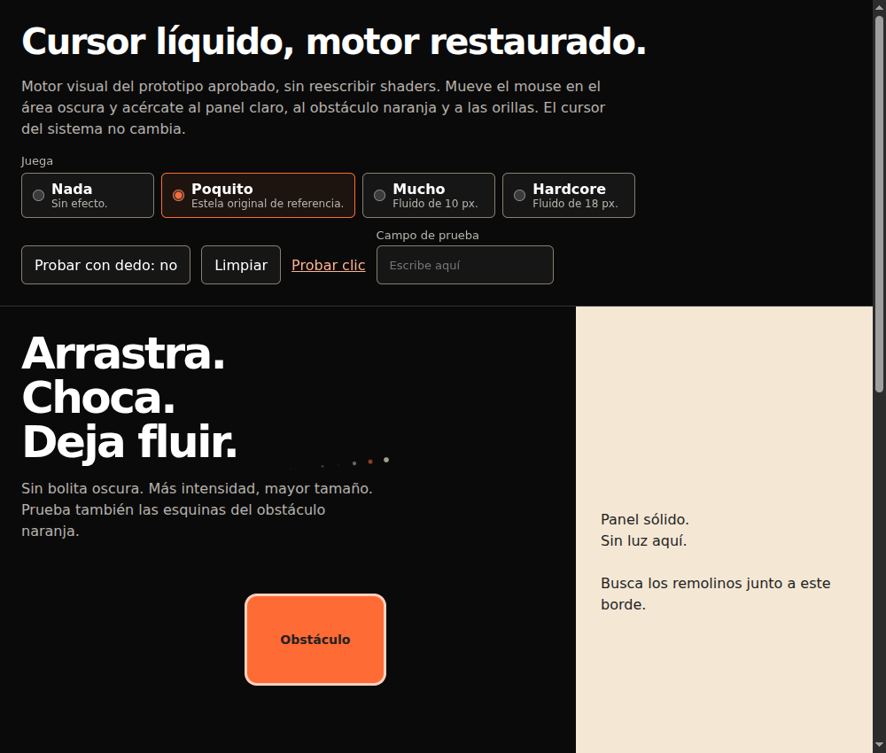
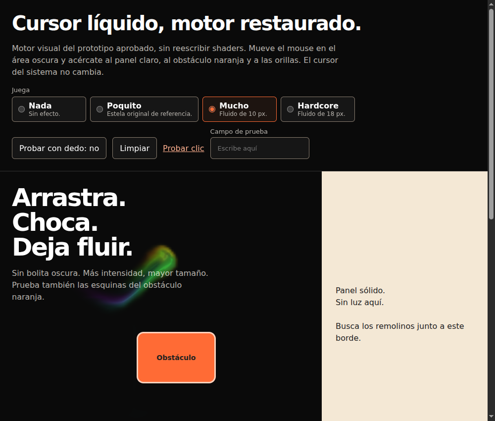
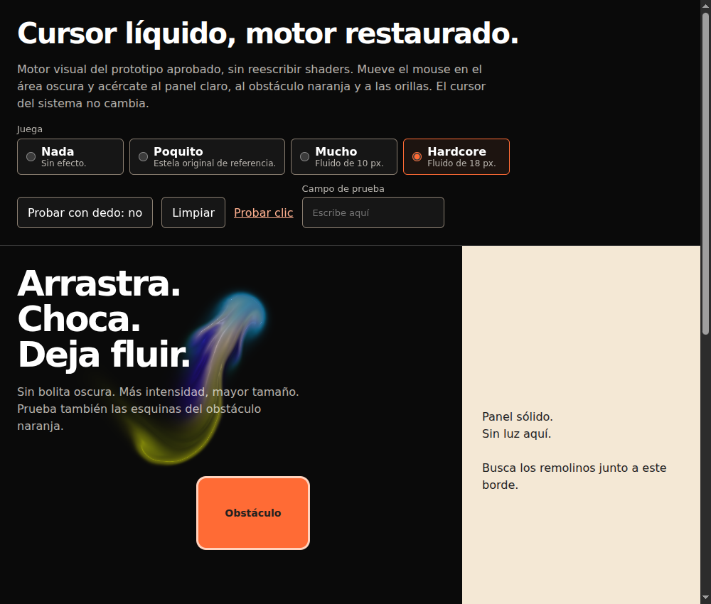
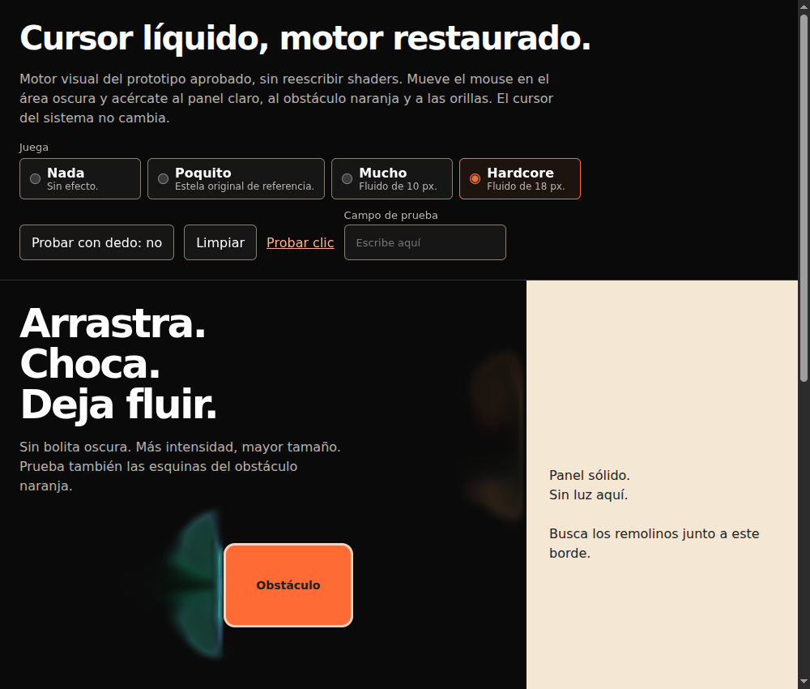

<div align="center">

<a href="https://github.com/jorgefsb/cursor-liquido/releases/tag/v1.0.1"></a>

<br />

<a href="./README.md"></a>


<br />

**[▶ Descargar la versión 1.0.1](https://github.com/jorgefsb/cursor-liquido/releases/tag/v1.0.1)** · Más proyectos en [github.com/jorgefsb](https://github.com/jorgefsb)

</div>

---

<p align="center"></p>
<p align="center"><sub>Grabación real, sin retoque. Chromium con WebGL por software. <a href="docs/media/cursor-liquido-restaurado-real.mp4">Ver el video MP4</a></sub></p>

## ¿Qué es?

Una estela para el puntero de tu sitio web. Puede ser de puntitos ligeros o un fluido WebGL2 que choca con los bloques de tu página.

## ¿Para quién es?

Para quien tiene un sitio y quiere que se sienta vivo sin contratar a nadie ni cargar una librería pesada. Si te gustan los efectos de las páginas de Jorge, este es ese cursor, gratis.

## ¿Qué dolor resuelve?

Los efectos de cursor suelen estorbar: reemplazan el puntero, tapan clics, traen dependencias o marean a quien pidió menos movimiento.

## La propuesta

Un efecto que acompaña y no manda:

- El cursor del sistema no cambia.
- La capa decorativa no intercepta clics.
- No hay dependencias en runtime.
- Con movimiento reducido no hay efecto.
- Tú eliges la intensidad al integrar. No se le pregunta nada al visitante.

| Intensidad | Qué dibuja |
|---|---|
| `nada` | Nada |
| `poquito` | Puntitos de 7 px que caen y se apagan. Sin WebGL |
| `mucho` | Fluido WebGL2 multicolor, radio de 10 px |
| `hardcore` | Fluido WebGL2 multicolor, radio de 18 px |

| Poquito | Mucho | Hardcore | Choque con un bloque |
|---|---|---|---|
|  |  |  |  |

## ¿Cómo se usa?

1. Descarga la [versión 1.0.1](https://github.com/jorgefsb/cursor-liquido/releases/tag/v1.0.1).
2. Copia `dist/` a tu sitio como `/vendor/cursor-liquido/`.
3. Pega esto en tu página:

```html
<link rel="stylesheet" href="/vendor/cursor-liquido/cursor-liquido.css">
<script src="/vendor/cursor-liquido/cursor-liquido.js"></script>
<script>
  LiquidCursor.mount({ intensity: 'poquito' })
</script>
```

4. Marca los bloques que el fluido debe rodear:

```html
<aside data-liquid-obstacle>…</aside>
```

## ¿Cuándo conviene y cuándo no?

Conviene en sitios de fondo oscuro, donde el fluido se aprecia mejor, y cuando quieres decidir tú la intensidad.

Límites de hoy:

- No está publicado en npm. No uses `npm install cursor-liquido`.
- No hay demo pública todavía. Abre `demo/index.html` en tu navegador; funciona sin servidor.
- El tacto viene apagado y no se probó en teléfonos físicos.
- Sin WebGL2, `mucho` y `hardcore` se apagan y `poquito` sigue.

## ¿Dónde lo pruebo?

Descarga: **[versión 1.0.1](https://github.com/jorgefsb/cursor-liquido/releases/tag/v1.0.1)**. Demo local: `demo/index.html`.

## Hasta dónde llegamos

Versión 1.0.1 estable, con licencia MIT. La suite corre 42 casos en navegador real y 8 comparaciones de calidad.

En ideas, sin implementar: una intensidad más, «Legendario». Está en [docs/roadmap.md](./docs/roadmap.md).

## Para quien construye

```sh
npm ci
npm test               # hash del motor, build determinista, manifest, sintaxis y privacidad
npm run test:browser   # navegador real sobre dist/
npm run test:quality   # comparaciones de reducción de calidad
```

API, opciones, integración con Juice y Game Feel, accesibilidad y rollback: [guía técnica](./docs/GUIA-TECNICA.md) y [docs/api.md](./docs/api.md).

## Licencia y créditos

Código MIT, (c) 2026 Jorge Suárez ([LICENSE](./LICENSE)). El sombreado del fluido está adaptado de WebGL Fluid Simulation de Pavel Dobryakov (MIT); ver [THIRD_PARTY_NOTICES](./THIRD_PARTY_NOTICES). Este repo no incluye ni licencia a Moki ni otros recursos de marca.

---

<div align="center">

<sub>Hecho con amor ❤️🎮 por <a href="https://jorgesuarez.com.mx">JorgeSuarez.com.mx</a> · <a href="https://github.com/jorgefsb">Más proyectos</a> · <a href="./README.md">Read in English</a><br />Documentación actualizada el 10 nov 2026.</sub>

</div>
