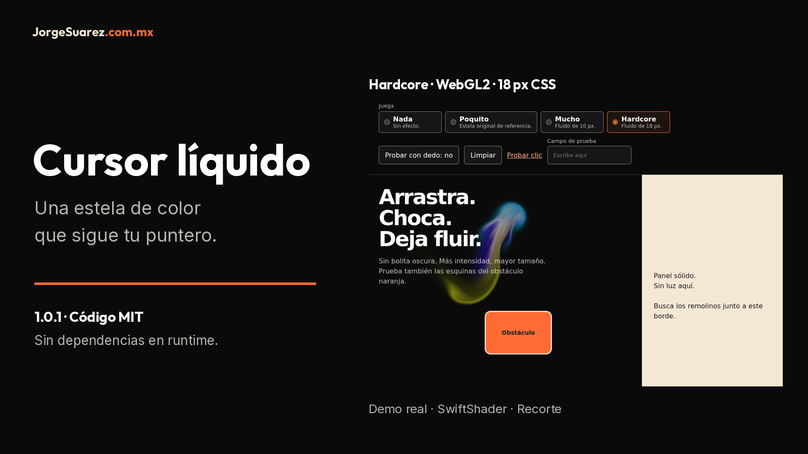

# Cursor líquido

[English](README.en.md) · Español

<picture>
  <source media="(max-width: 600px)" srcset="docs/media/cover-es-mobile.png">
  
</picture>

Una estela de color que sigue el puntero de tu página. Hecho por [Jorge Suárez](https://brandkit.jorgesuarez.com.mx/).

[Descargar demo HTML 1.0.1](https://github.com/jorgefsb/cursor-liquido/releases/download/v1.0.1/cursor-liquido.html) · [Ver video real (MP4, 13 s)](docs/media/cursor-liquido-restaurado-real.mp4)

## ¿Qué es?

Una pieza de código para páginas web. Dibuja puntitos o fluido detrás del puntero; no cambia el cursor del sistema ni intercepta clics. Versión del código en esta copia: 1.0.1, sin dependencias en runtime.

## ¿Para quién es?

Para quien tiene una página y quiere añadir un efecto decorativo al mover el mouse. Puedes probarlo sin programar; para ponerlo en tu sitio necesitas acceso a sus archivos y ayuda de quien lo desarrolla. No requiere Juice, Moki ni una cuenta.

## ¿Por qué se hizo?

Para compartir el efecto de las páginas de Jorge como una pieza reutilizable, con cuatro intensidades y una forma de apagarlo. La decoración no promete más ventas ni mejor usabilidad.

## ¿Cómo lo uso?

Primero descarga o clona [este repositorio](https://github.com/jorgefsb/cursor-liquido). Abre [demo/index.html](demo/index.html) con doble clic en tu navegador. Elige Poquito y mueve el mouse en la zona oscura. Prueba Mucho o Hardcore cerca del obstáculo naranja y del panel claro; Nada apaga el efecto. No hace falta instalar Node para probarlo.

Para compartir un solo archivo sin red, abre [dist/cursor-liquido-standalone.html](dist/cursor-liquido-standalone.html). Si estás leyendo esto en GitHub, descarga primero el archivo: la vista de código no ejecuta la demo. La interfaz original conserva sus etiquetas en español también en la guía inglesa.


Captura real: Hardcore está seleccionado; el fluido aparece junto al bloque naranja y el panel claro queda libre de luz. Es una muestra, no una certificación de dispositivos.

[Ver el video real (13 s)](docs/media/cursor-liquido-restaurado-real.mp4) · [Subtítulos ES](docs/media/walkthrough.es.vtt) · [Explicación por momentos](docs/walkthrough.md) · [Reproductor con subtítulos para abrir localmente](docs/showcase.html)

Para usar el reproductor, descarga o clona el repositorio y abre `docs/showcase.html` en tu navegador. GitHub muestra su código, no un reproductor HTML alojado.

## ¿Cuándo conviene usarlo y cuándo no?

Úsalo como adorno opcional en una página oscura. Evítalo sobre texto con contraste justo, formularios importantes o cuando distraiga. Con movimiento reducido se apaga; en tacto viene apagado. Mucho y Hardcore necesitan WebGL2 y `EXT_color_buffer_float`; sin ellos no dibujan fluido. Poquito no usa WebGL.

Probado con Chromium headless y WebGL por software (SwiftShader), no en teléfonos físicos ni en todas las GPU. `color` solo modifica Poquito; el fluido es multicolor. No hay nivel Legendario implementado.

## ¿Dónde lo pruebo o descargo?

En esta copia local: [demo](demo/index.html) o [archivo autónomo](dist/cursor-liquido-standalone.html). La fuente es [jorgefsb/cursor-liquido](https://github.com/jorgefsb/cursor-liquido). Puedes descargar el [HTML autónomo de Release v1.0.1](https://github.com/jorgefsb/cursor-liquido/releases/download/v1.0.1/cursor-liquido.html) o el [ZIP cursor-liquido-1.0.1.zip](https://github.com/jorgefsb/cursor-liquido/releases/download/v1.0.1/cursor-liquido-1.0.1.zip). Son enlaces de descarga de la release existente, verificados por el responsable del repositorio; no una nueva publicación de este trabajo. No se ha verificado aquí una demo pública alojada. No hay paquete npm publicado: no uses `npm install cursor-liquido`. Esta revisión actualiza documentación; no cambia el runtime ni crea una nueva release.

## Costo, requisitos y privacidad

El código es gratis bajo [MIT](LICENSE), también para uso comercial, conservando los avisos de licencia. La integración, el alojamiento y el soporte de tu sitio pueden tener sus propios costos; no se incluye servicio de instalación ni soporte con plazo garantizado. El motor atribuye a Pavel Dobryakov en [THIRD_PARTY_NOTICES](THIRD_PARTY_NOTICES).

Para probar: computadora, navegador y mouse; para el fluido, WebGL2 compatible. Para integrar: HTML/CSS/JavaScript y acceso al sitio. Node 18 o superior y Playwright solo se requieren para desarrollo y pruebas.

El módulo trabaja en el navegador: no incluye analítica, cuentas ni solicitudes de red. Las posiciones del puntero se procesan en memoria; el módulo no usa cookies ni almacenamiento local para guardarlas. Destruir la instancia elimina sus capas y listeners. La demo local funciona sin red. Esto no describe las políticas del sitio que lo integre ni de GitHub al descargar. La firma y las imágenes de marca no son MIT: consulta [aviso de recursos](docs/ASSET-NOTICE.md).

## Elegir intensidad

| Intensidad | `data-jz-level` opcional | Resultado |
|---|---|---|
| `nada` | `off` | Sin efecto. |
| `poquito` | `subtle` | Puntitos de 7 px, vida de 480 ms, sin WebGL. |
| `mucho` | `full` | Fluido multicolor, radio de 10 px CSS. |
| `hardcore` | `hard` | Fluido multicolor, radio de 18 px CSS. |


Medios reales reutilizados de la demo aprobada, con el mismo motor y adaptador. Capturados mediante entrada de Playwright, 1000 × 850, SwiftShader. La [guía del video](docs/walkthrough.md) explica su procedencia y sus límites.

## Para quien desarrolla el sitio

Copia `dist/` a `/vendor/cursor-liquido/` y agrega después del contenido de la página:

```html
<link rel="stylesheet" href="/vendor/cursor-liquido/cursor-liquido.css">
<script src="/vendor/cursor-liquido/cursor-liquido.js"></script>
<script>
  LiquidCursor.mount({ intensity: 'poquito' })
</script>
```

Marca bloques con `data-liquid-obstacle`. Verifica los archivos contra `dist/manifest.json`. Sin intensidad explícita o atributo de origen, `mount()` lanza error. La integración con Juice es opcional: `LiquidCursor.mount({ followJuice: true })` lee `data-jz-level` sin escribirlo. Una página debe tener un solo dueño del cursor.

[API](docs/api.md) · [Integraciones](docs/integrations.md) · [Accesibilidad y rendimiento](docs/accessibility-performance.md) · [Apagar o volver atrás](docs/rollback.md) · [Planes, no implementados](docs/roadmap.md) · [Cambio técnico 1.0.1](docs/quality-input-candidate.es.md)

```sh
npm ci
npm test
npm run test:browser
npm run test:quality
```

Para reutilizar Playwright instalado, usa `PLAYWRIGHT_MODULE=/ruta/absoluta/a/node_modules/playwright`. [Contribuir](CONTRIBUTING.md) · [Instrucciones para agentes](skills/cursor-liquido/SKILL.es.md) · [Reglas de documentación](docs/REPOSITORY-DOCUMENTATION.md). [CHANGELOG](CHANGELOG.md) y [RELEASE-NOTES](RELEASE-NOTES.md) conservan los registros históricos sin traducir eventos.

## Ayuda

Si falla, elige `poquito` o [apaga el efecto](docs/rollback.md). Abre un [issue](https://github.com/jorgefsb/cursor-liquido/issues) con versión, navegador, sistema y GPU si la conoces, sin información personal. Para instalarlo en una página, comparte la guía técnica con quien mantiene tu sitio.
