<div align="center">

<a href="https://github.com/jorgefsb/cursor-liquido/releases/tag/v1.0.1"></a>

<br />


<a href="./README.es.md"></a>

<br />

**[▶ Download version 1.0.1](https://github.com/jorgefsb/cursor-liquido/releases/tag/v1.0.1)** · More projects at [github.com/jorgefsb](https://github.com/jorgefsb)

</div>

---

<p align="center"></p>
<p align="center"><sub>Real recording, no retouching. Chromium with software WebGL. <a href="docs/media/cursor-liquido-restaurado-real.mp4">Watch the MP4 video</a></sub></p>

## What is it?

A pointer trail for your website. It can be light dots or a WebGL2 fluid that collides with the blocks on your page.

## Who is it for?

For anyone with a site who wants it to feel alive without hiring anyone or loading a heavy library. If you like the effects on Jorge's pages, this is that cursor, for free.

## What pain does it solve?

Cursor effects tend to get in the way: they replace the pointer, cover clicks, bring dependencies or make people who asked for less motion feel sick.

## The proposal

An effect that follows along and does not take over:

- The system cursor does not change.
- The decorative layer never intercepts clicks.
- No runtime dependencies.
- With reduced motion there is no effect.
- You choose the intensity when you integrate it. The visitor is never asked anything.

| Intensity | What it draws |
|---|---|
| `nada` | Nothing |
| `poquito` | 7 px dots that fall and fade. No WebGL |
| `mucho` | Multicolor WebGL2 fluid, 10 px radius |
| `hardcore` | Multicolor WebGL2 fluid, 18 px radius |

| Poquito | Mucho | Hardcore | Hitting a block |
|---|---|---|---|
|  |  |  |  |

## How do I use it?

1. Download [version 1.0.1](https://github.com/jorgefsb/cursor-liquido/releases/tag/v1.0.1).
2. Copy `dist/` to your site as `/vendor/cursor-liquido/`.
3. Paste this into your page:

```html
<link rel="stylesheet" href="/vendor/cursor-liquido/cursor-liquido.css">
<script src="/vendor/cursor-liquido/cursor-liquido.js"></script>
<script>
  LiquidCursor.mount({ intensity: 'poquito' })
</script>
```

4. Mark the blocks the fluid should flow around:

```html
<aside data-liquid-obstacle>…</aside>
```

## When it fits and when it doesn't

It fits on dark sites, where the fluid shows best, and when you want to decide the intensity yourself.

Today's limits:

- It is not published on npm. Do not run `npm install cursor-liquido`.
- There is no public demo yet. Open `demo/index.html` in your browser; it works without a server.
- Touch is off by default and it was not tested on physical phones.
- Without WebGL2, `mucho` and `hardcore` turn off and `poquito` keeps working.

## Where can I try it?

Download: **[version 1.0.1](https://github.com/jorgefsb/cursor-liquido/releases/tag/v1.0.1)**. Local demo: `demo/index.html`.

## How far we got

Stable version 1.0.1 under the MIT license. The suite runs 42 cases in a real browser and 8 quality comparisons.

An idea that is not implemented: one more intensity, "Legendario". It is in [docs/roadmap.md](./docs/roadmap.md) (in Spanish).

## For builders

```sh
npm ci
npm test               # engine hash, deterministic build, manifest, syntax and privacy
npm run test:browser   # real browser on dist/
npm run test:quality   # quality reduction comparisons
```

API, options, Juice and Game Feel integration, accessibility and rollback: [technical guide](./docs/GUIA-TECNICA.md) and [docs/api.md](./docs/api.md) (in Spanish, with an English usage section).

## License and credits

MIT code, (c) 2026 Jorge Suárez ([LICENSE](./LICENSE)). The fluid shader is adapted from WebGL Fluid Simulation by Pavel Dobryakov (MIT); see [THIRD_PARTY_NOTICES](./THIRD_PARTY_NOTICES). This repo does not include or license Moki or any other brand asset.

---

<div align="center">

<sub>Made with love ❤️🎮 by <a href="https://jorgesuarez.com.mx">JorgeSuarez.com.mx</a> · <a href="https://github.com/jorgefsb">More projects</a> · <a href="./README.es.md">Leer en español</a><br />Documentation updated on 10 Nov 2026.</sub>

</div>
